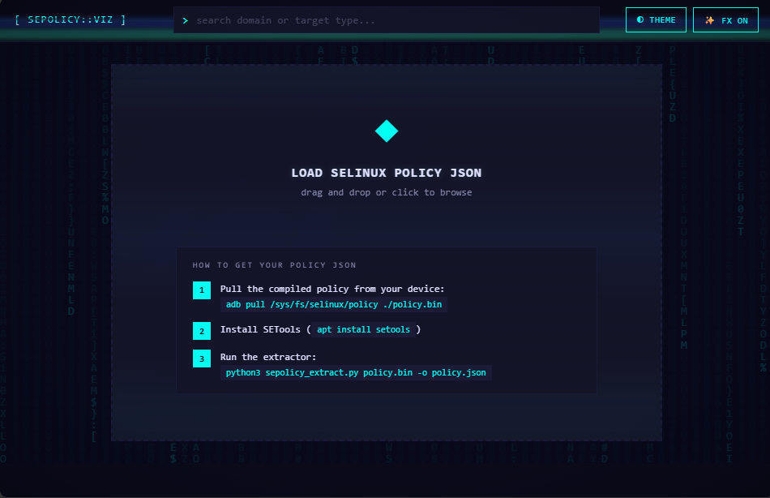
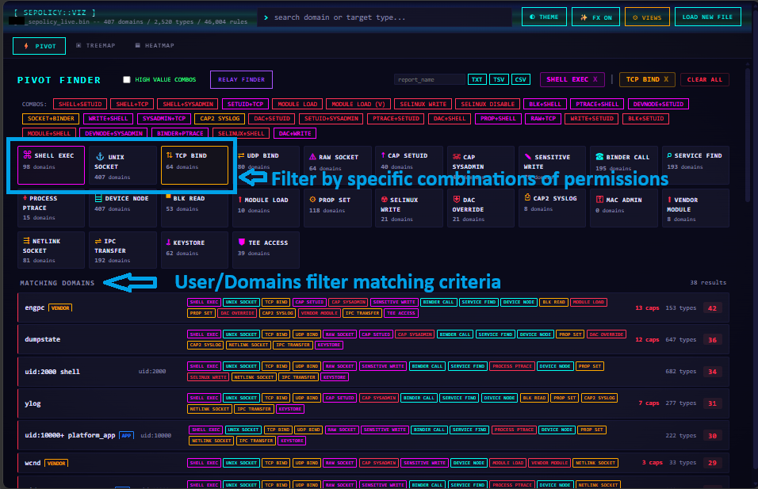
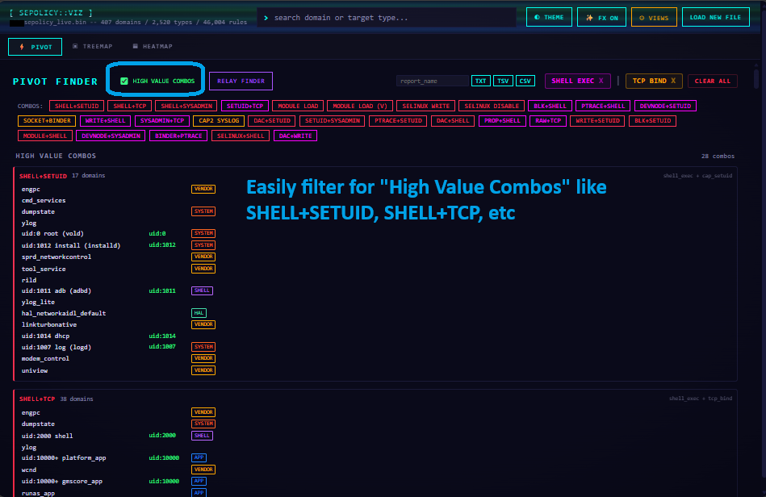

# SEPolicy Viz

Interactive visualization toolkit for Android SELinux policy analysis. Loads a compiled policy binary (via the included extractor) and renders it across 15 views — heatmaps, graphs, treemaps, pivot finders, execution chain DAGs, entropy analysis, and more.

No server required. Open `index.html` in a browser, drop a policy JSON, start auditing.

## Screenshots




## Quick Start

1. Open `index.html` in Chrome/Firefox/Edge
2. Drag your `policy.json` onto the drop zone (or click to browse)
3. Use tabs to switch views. Only 3 are shown by default — click `VIEWS` in the header to enable more.

## Creating Your Policy JSON

### Step 1: Get the policy binary from your device

```bash
adb pull /sys/fs/selinux/policy ./device_policy.bin
```

Alternative paths (varies by device/firmware):
- `/vendor/etc/selinux/precompiled_sepolicy`
- `/sepolicy`
- Extract from a firmware image at the same paths

### Step 2: Install SETools

```bash
# Debian/Ubuntu
sudo apt install setools

# Fedora/RHEL
sudo dnf install setools-console
```

This provides the `sesearch` and `seinfo` commands the extractor shells out to.

### Step 3: Run the extractor

```bash
python3 sepolicy_extract.py device_policy.bin -o policy.json
```

Python 3.6+ required. Standard library only — no pip packages.

```
Extracting domains from device_policy.bin...
  407 domains found
Extracting allow rules...
  46004 rules, 2520 target types, 87 classes
Extracting dontaudit rules...
  5231 dontaudit rules (hidden denials)
Extracting type_transition rules...
  1847 type_transition rules
Written policy.json (8.2 MB)
```

## CLI Query Tool

`pivot_query.py` runs adversarial queries against the same JSON from the command line. Useful for scripted audits or when you need quick answers without the browser.

```bash
python3 pivot_query.py policy.json domain wcnd          # everything wcnd can do
python3 pivot_query.py policy.json who-writes vendor_data_file  # who writes here
python3 pivot_query.py policy.json combo capability:setuid shell_exec:execute_no_trans
python3 pivot_query.py policy.json relay vendor_data_file       # writer->reader chains
python3 pivot_query.py policy.json broad                 # rank by privilege breadth
python3 pivot_query.py policy.json presets               # run all 28 adversarial combos
python3 pivot_query.py policy.json who-targets system_server    # who can act on this domain
```

Full command list: `python3 pivot_query.py -h`

## Shell Controls

**THEME** — Switch between color presets (Default, Midnight, Slate, Carbon, Terminal Green). Includes a background color picker with save/clear — the override persists across preset switches and page reloads.

**FX ON/OFF** — Toggle visual effects (scanlines, copper bars, matrix rain, raster glow). Turning FX off gives a clean, flat UI.

**VIEWS** — Enable/disable individual views. Only Pivot, Treemap, and Heatmap are shown by default. Enable more from this menu. Choices persist across reloads.

**Search** — Type a domain or target-type name in the search bar. Autocomplete suggests matches. Enter selects the top match and navigates to it in the active view.

## Views — Detailed Guide

### PIVOT — Threat Category Finder

The starting point for most audits. Shows 24 threat category cards (Shell Exec, Cap Setuid, Selinux Write, Module Load, etc.) with domain counts. Click a card to filter — shows all domains matching that category with:
- Text labels for every category the domain matches
- Capability count and target-type count per domain
- Threat score (higher = more dangerous combinations)
- Click a domain row to jump to its graph view

**High Value Combos** — toggle the checkbox to show the 28 preset adversarial combos (same as `pivot_query.py presets`) ranked by match count.

**Relay Finder** — enter two domain names to find shared target types where one writes and the other reads. Identifies data relay chains for lateral movement.

**Export** — enter a report name, click TXT/TSV/CSV to download the current filter results or high-value combos as a file.

### HEATMAP — Domain x Type Matrix

Rows = domains (grouped by category). Columns = target types (sorted by how many domains access them). Each cell is colored by the dominant object class of rules in that cell:
- Cyan = file class
- Magenta = process class
- Red = capability
- Amber = binder
- Green = socket types
- Purple = chr_file / blk_file

**Hide Common** — checkbox in the toolbar. Hides target-type columns accessed by 30%+ of all domains. These are attribute-inherited grants (domain, coredomain, appdomain) that create uniform horizontal bands obscuring per-domain differences. Turn this on for cleaner analysis.

**Zoom** — `+`/`-` buttons or mouse wheel. Zoom into dense regions of the matrix.

**Click a row label** — selects that domain, highlights its row, shows full permissions in a detail popup.

**Click a cell** — shows a popup with the exact class:permissions for that domain+type pair. From the popup you can jump to graph view or open a reverse lookup.

### TREEMAP — Privilege Area Map

Nested rectangles where area = rule count. Three levels: category > domain > target type. The biggest rectangles are the most privileged domains.

**Click** a category block to drill into it. Click a domain to drill into its targets. Breadcrumb nav at top to go back up.

**INVERT** — button in the toolbar. Inverts the color scheme for readability.

**Zoom** — mouse wheel zooms, drag to pan. `+`/`-` buttons and reset.

**Right-click** a target type to open it in a floating detail window.

### GRAPH — Domain Relationship Explorer

Force-directed graph centered on a selected domain. Shows all target types that domain can access as connected nodes. Click a target node to expand its connections — reveals other domains that share access to the same type.

**Click a node** to expand it (pull in up to 15 connected neighbors per click). The graph grows outward layer by layer.

**Properties panel** (right side) — shows the selected domain's full permissions grouped by class.

**Reverse Lookup** — from a cell popup in the heatmap, click "REVERSE" to see all domains that access a given target type.

**Compare** — select two domains to see a side-by-side comparison of their permissions. Shared permissions are highlighted in the center column.

**Floating Windows** — right-click a target type to spawn a draggable detail window. Multiple windows can be open simultaneously.

### AUDIT — Policy Metadata Inspector

Tabular view of policy metadata that doesn't fit in other views:

- **Permissive Domains** — domains where SELinux logs violations but does not enforce. All policy analysis for permissive domains is meaningless since they can do anything.
- **Dontaudit Rules** — rules that silently suppress AVC denials from audit logs. Sorted by domain, showing hidden operations. If you're running `dmesg | grep avc` and not seeing expected denials, check here.
- **Type Transitions** — domain execution chains. Shows "when domain A executes binary X, the process transitions to domain B." Filtered to process-class transitions between actual domains.
- **Attributes** — SELinux attribute groups sorted by membership count. Shows which attributes are broadest (most members).
- **High Value Domains** — ranked by capability count + target reach. Click any row to jump to its graph view.

### SCATTER — Domain Risk Scatterplot

Each domain plotted as a dot on two selectable axes. Default: X = target-type breadth, Y = capability count.

**Axis dropdowns** — select from: Rule Count, Capability Count, Target Type Breadth, Exec Type Count, Write Target Count, Dontaudit Count, Transition Fan-out.

**Category chips** — click to show/hide categories. Useful for isolating vendor domains against the system baseline.

**Dot size** = total rule count. **Color** = category. **Hover** shows all 7 metrics. **Click** jumps to graph view.

Domains in the upper-right quadrant (high on both axes) are the most over-privileged and worth investigating.

### DONTAUDIT — Shadow Heatmap

A specialized heatmap showing the relationship between allow rules and dontaudit rules. Three cell states:
- **Solid** = allow only (normal grant)
- **Striped** = dontaudit only (invisible wall — blocked but no audit log generated)
- **Solid + stripe** = both allow AND dontaudit (suspicious overlap)

Only shows domains that have dontaudit rules. Sorted by dontaudit count. Hover for full permission details.

### TRANS DAG — Execution Transition Graph

Directed graph of domain-to-domain transitions through exec. Nodes = domains. Edges = "when source executes binary X, transitions to destination domain."

**Path Finder** — select a source and target domain, click Find Paths. Uses BFS to find all shortest paths and highlights them. Shows each path with the exec types (binaries) that trigger each hop.

**Click a node** — highlights direct predecessors (red) and successors (green).

**Search** — type a domain name to center the view on it.

This answers "can I reach domain Z from my foothold in domain A?" — the execution reachability question.

### PARALLEL — Multi-Dimension Domain Profile

Each vertical axis is a domain metric. Each domain is a polyline crossing all 7 axes: Rule Count, Capability Count, Target Type Breadth, Exec Type Count, Write Target Count, Dontaudit Count, Transition Fan-out.

**Brush** — click-drag on any axis to select a range. Only domains passing through ALL active brushes survive (AND logic). Everything else dims. Drag "Capability Count > 8" to see which domains are over-privileged.

**Drag axis labels** to reorder the dimensions.

**Category legend** — click to toggle categories on/off.

### ENTROPY — Permission Class Distribution

Shannon entropy of each domain's rule-class distribution. Low entropy (left) = tightly focused on 1-2 classes (expected for purpose-built daemons). High entropy (right) = rules spread across many classes (investigate for over-privilege).

Two strips: one for allow rules, one for dontaudit rules. Top-10 highest and top-5 lowest entropy domains are auto-labeled. Brush to filter.

### CLUSTERED — Similarity-Reordered Heatmap

Same domain x type matrix as the heatmap, but with rows and columns reordered by Jaccard similarity using a greedy nearest-neighbor seriation algorithm.

**Category mode** — rows grouped by category (same as regular heatmap). **Clustered mode** — rows reordered so structurally similar domains are adjacent, regardless of category. A vendor domain that behaves like a system domain will cluster next to system domains.

**Noise filter** — slider to hide target types accessed by more than N% of domains.

### UPSET — Attribute Set Intersections

UpSet plot showing which combinations of SELinux attributes are most common. Top bar chart = frequency of each combination. Dot matrix = which attributes are in each combo. Left bars = per-attribute membership count.

Click a bar to see which domains have that exact attribute set. Domains with unique or rare attribute combinations are worth investigating — they were either deliberately special-cased or accidentally left in an unusual state.

### MARGINAL — Heatmap with Distributions

Enhanced heatmap with histogram sparklines along both edges. Left margin = per-domain rule count. Top margin = per-type domain-reach count. The marginals show the univariate distributions that contextualize the matrix.

### SIMILAR — Domain Similarity Network

All domains as nodes in a single force-directed graph. Edges = Jaccard similarity of their target-type permission sets. Domains that access similar types cluster together.

**Threshold slider** (0.05 to 0.50) — controls which edges are shown. Lower = more connections (denser). Higher = only strongest similarities (cleaner clusters).

**Click a node** — side panel shows its top-10 most similar domains with Jaccard scores.

Precomputes ~83K pairwise similarities on load (progress bar shown).

### SANKEY — Permission Flow Diagram

Aggregate rule flow from domain categories (left) through object classes (middle) to permission groups (right). Width = rule count.

**Toggle** — switch between Allow Rules and Dontaudit Rules. The comparison is revealing — where is the policy hiding activity vs. where is it granting access?

**Hover** a flow to see exact rule count and percentage. **Click** a category to filter to only that category's flows.

## Customization

### Enabling/Disabling Views

Click `VIEWS` in the header. Toggle any view on or off. Only enabled views appear as tabs. Defaults: Pivot, Treemap, Heatmap. Persists in localStorage.

### Themes

Click `THEME` in the header. Select a preset or use the color picker to set a custom background. Click SAVE to persist the background override — it survives preset switches and page reloads. Click CLEAR to revert to the preset default.

### Adding a New View

1. Create `js/views/my-view.js`:

```js
(function() {
  var styleEl = null;
  App.registerView('my-view', {
    label: 'MY VIEW',
    icon: '★',
    create: function(el) {
      styleEl = document.createElement('style');
      styleEl.textContent = '.mv { padding: 20px; color: var(--cyan); }';
      document.head.appendChild(styleEl);
      el.innerHTML = '<div class="mv">Rule count: ' + App.data.rules.length + '</div>';
    },
    destroy: function() {
      if (styleEl) { styleEl.remove(); styleEl = null; }
    }
  });
})();
```

2. Add `'my-view'` to the array in `js/views.js`

No other files need to change.

## Data API for Views

Views access data through the `App` global:

| Property | Type | Contents |
|----------|------|----------|
| `App.data` | Object | Raw policy JSON |
| `App.data.rules` | Array | `[{s, t, c, p}, ...]` — allow rules |
| `App.data.dontaudit_rules` | Array | Same shape as rules |
| `App.data.type_transitions` | Array | `[{s, t, c, d}, ...]` |
| `App.data.attributes` | Object | `{attr: [member_types]}` |
| `App.state.domains` | Array | Ordered domain list |
| `App.state.domainCategory` | Object | `{domain: category}` |
| `App.state.domainTypeMap` | Object | `{domain: {type: [{c, p}]}}` |
| `App.state.domainTypeSet` | Object | `{domain: Set}` |
| `App.state.domainRuleCounts` | Object | `{domain: count}` |
| `App.state.permissiveDomains` | Set | Domains in permissive mode |
| `App.state.types` | Array | Ordered type list |
| `App.state.typeDomainCount` | Object | `{type: count}` |
| `App.CATS` | Array | Category order |
| `App.CAT_COLORS` | Object | `{category: hex}` |
| `App.tooltip.show(x,y,html)` | Function | Show shared tooltip |
| `App.tooltip.hide()` | Function | Hide tooltip |
| `App.escapeHTML(s)` | Function | HTML-escape a string |
| `App.el(tag,cls,html)` | Function | Create a DOM element |
| `App.fmtNum(n)` | Function | Format number with locale separators |

## Distribution Package

```
sepolicy_viz/
├── index.html
├── README.md
├── theme.json             (optional bg color override)
├── css/
│   └── theme.css
├── js/
│   ├── d3.v7.min.js
│   ├── d3-sankey.min.js
│   ├── views.js
│   ├── core.js
│   ├── data.js
│   ├── ui.js
│   └── views/
│       └── *.js           (15 view files)
├── tools/
│   ├── sepolicy_extract.py
│   └── pivot_query.py
└── sample/
    └── policy.json        (optional)
```

Zero external dependencies for the visualizer. SETools required only for the extraction step.

## Requirements

- **Browser:** Chrome, Firefox, or Edge (modern)
- **Extractor:** Python 3.6+, SETools (`sesearch`/`seinfo` on PATH)
- **No server required** — works from `file://`

## Architecture

The shell (`index.html` + `core.js` + `data.js` + `ui.js`) loads views dynamically from the `views.js` manifest. Each view is a self-contained JS file that self-registers with `App.registerView()` and receives a container element to draw into. Views own their CSS (injected on activation, removed on deactivation). The framework routes tabs and delivers data. Views handle everything else.

Adding a view = drop a .js file + add one string to the manifest. Removing a view = delete both.

## License

See project root for license terms.
